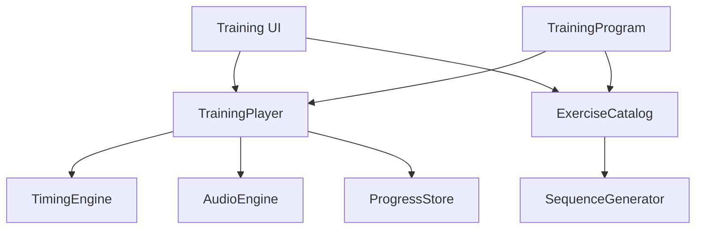

# Архитектура

## Рекомендуемый стек
TypeScript, React + Vite (или эквивалентный компонентный UI), Zod, IndexedDB, Web Audio API. MediaRecorder — позднее. Backend не требуется.

## Модули
- `ExerciseCatalog` — загрузка, валидация, фильтрация контента.
- `SequenceGenerator` — repeat/alternate/reverse/permute/shuffle/interleave/cascade/mirror, seed.
- `TrainingPlayer` — явная машина состояний.
- `TimingEngine` — дедлайны, пауза, темп, beatsPerElement.
- `AudioEngine` — метроном, звуковые сигналы, mute.
- `TrainingProgram` — последовательность упражнений и длительности.
- `ProgressStore` — IndexedDB и экспорт JSON.
- `AudioRecorder` — опционально, вне MVP.



## Модель упражнения
```ts
type Exercise = {
  id: string;
  type: 'sequence' | 'tongue_twister';
  category: 'vowels' | 'consonants' | 'mixed' | 'tongue_twisters';
  title: string;
  difficulty: 1 | 2 | 3 | 4 | 5;
  group?: string;
  elements?: string[];
  text?: string;
  segments?: string[];
  phoneticTargets?: string[];
  generation?: {
    operation: 'repeat'|'alternate'|'reverse'|'permute'|'shuffle'|'interleave'|'cascade'|'mirror';
    count?: number;
    seed?: number;
  };
  playback?: {
    mode: 'manual'|'timed'|'metronome';
    bpm?: number;
    beatsPerElement?: number;
    elementDurationMs?: number;
    pauseBetweenRoundsMs?: number;
  };
};
```

## Контент
`data/vowels.json`, `data/consonants.json`, `data/tongue_twisters.json`, `data/programs.json`. Все файлы UTF-8, контентные идентификаторы стабильны. Для скороговорок хранить текст без потери пунктуации, сегментацию — отдельно.

## Состояние проигрывателя
`idle`, `countdown`, `running`, `resting`, `paused`, `completed`, `cancelled`, `error`.
События: `START`, `COUNTDOWN_DONE`, `TICK`, `NEXT`, `PREV`, `PAUSE`, `RESUME`, `ROUND_DONE`, `COMPLETE`, `CANCEL`, `FAIL`.

## Нефункциональные решения
- Для точного визуального расписания хранить время начала и ожидаемые дедлайны; не считать тики источником истины.
- Для аудиометронома планировать звуки Web Audio с небольшим lookahead.
- При смене темпа пересчитывать будущие события, не менять уже сыгранные.
- Для offline-доступа после первой загрузки можно добавить service worker/PWA-кеширование.
- Контентные ошибки и отсутствующие API не должны ломать весь экран.
