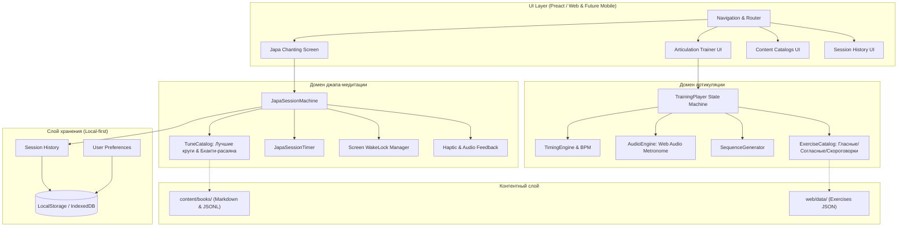

# Архитектура системы

**Версия:** 2.0 · **Язык:** русский · **Статус:** архитектурный документ.

Документ описывает структуру приложения, разделение на домены, поток данных и стратегию переноса функционала с Web-платформы на мобильные приложения iOS и Android.

---

## 1. Концептуальная архитектура

Система построена на принципах чистой компонентной архитектуры без обязательного серверного бэкенда (Client-Only / Offline-First).

В системе выделены два основных домена:
1. **Домен артикуляции (Articulation Domain):** тренировка речевого аппарата, проигрывание последовательностей гласных/согласных, метроном, генераторы слогов.
2. **Домен джапы (Japa Domain):** управление целями (4..64 круга), сессионный таймер, покруговая машина состояний, каталог настроек («Лучшие круги») и шлок («Бхакти-расаяна»), развязанный контроллер текстов, вибро- и аудиоотклик, удержание подсветки экрана (Wake Lock).



---

## 2. Модули домена джапы

### 2.1. `JapaSessionMachine` (Машина состояний сессии)
Управляет жизненным циклом сессии повторения мантры:
- **Состояния:** `TARGET_SELECT → TUNE_IN → CHANTING → COMPLETED`.
- **Контекст состояния (State Context):**
  - `targetRounds`: целевое количество кругов (4, 8, 16, 24, 32, 40, 48, 56, 64).
  - `currentRound`: номер текущего круга (1 .. targetRounds).
  - `currentTextIndex`: индекс отображаемого текста/шлоки.
  - `isTextLocked`: флаг, зафиксировал ли пользователь просмотр текста вручную.
  - `roundStartTime`: временная метка начала текущего круга.
  - `sessionStartTime`: временная метка старта всей сессии.
  - `durations`: массив длительностей завершенных кругов (в секундах).
- **События (Events):**
  - `SET_TARGET(target)`: выбор цели.
  - `START_CHANTING`: переход от преднастройки к кругу 1.
  - `NEXT_ROUND`: завершение текущего круга. Вызывает тактильный отклик, пересчитывает таймер. При `round < target` инкрементирует круг; при `round === target` переводит в `COMPLETED`.
  - `PREV_TEXT` / `NEXT_TEXT`: сдвиг отображаемого текста. **Не затрагивает `currentRound`**.
  - `SYNC_TEXT_TO_ROUND`: принудительный возврат карточки текста к настройке текущего круга.
  - `RESET_SESSION`: возврат к выбору цели.

### 2.2. `TuneCatalog` (Каталог настроек и священных текстов)
Обеспечивает загрузку, фильтрацию и быстрый доступ к духовным материалам:
- Коллекция 1: **«Лучшие круги»** — 16 глав, привязанных к кругам 1..16, с практическими советами по концентрации ума и цитатами из писаний.
- Коллекция 2: **«Шри Бхакти-расаяна»** — нормализованная база шлок (`Sri Bhakti Rasayana Slokas.jsonl`) со стихами на санскрите (IAST/кириллица), пословным и литературным переводом.

### 2.3. `Screen WakeLock Manager`
- Использует стандартный W3C Screen Wake Lock API.
- При переходе в состояние `CHANTING` запрашивает блокировку сна: `navigator.wakeLock.request('screen')`.
- При выходе из сессии, переходе в фон или размонтировании компонента аккуратно освобождает ресурс (`sentinel.release()`), предотвращая утечку батареи.

### 2.4. `Haptic & Sound Feedback`
- Обеспечивает подтверждение нажатия кнопки «Следующий круг»:
  - Вибрация: `navigator.vibrate([60])` на мобильных браузерах.
  - Аудио: синтез короткого мягкого щелчка бусины или воспроизведение звука каратал через Web Audio API.

---

## 3. Модули домена артикуляции

- `ExerciseCatalog`: загрузка и валидация данных упражнений (`vowels.json`, `consonants.json`, `tongue_twisters.json`, `programs.json`).
- `SequenceGenerator`: алгоритмы генерации цепочек звуков (перестановки, маятники, реверс, чередование).
- `TrainingPlayer`: машина состояний тайминга тренировки (`idle → countdown → running → resting → completed`).
- `TimingEngine`: вычисление дедлайнов по монотонным часам (`performance.now()`), независимость от троттлинга `setInterval`.
- `AudioEngine`: синтез метронома и звуковых маркеров начала/конца серий без внешних аудиофайлов.

---

## 4. Контентная архитектура и пайплайн данных

```
content/books/
├── luchshie-krugi/           # Исходные тексты в Markdown
│   ├── part01/ (01, 02)      # 5 условий и концентрация
│   └── part02/02/ (01..16, 99) # 16 настроек на каждый круг и молитва
└── bhakti-rasayana/
    ├── Sri Bhakti Rasayana (Elixir of Devotion).ru.md
    ├── Sri Bhakti Rasayana Slokas.md
    └── Sri Bhakti Rasayana Slokas.jsonl # Машиночитаемая база стихов
```

Для веб-клиента и мобильных приложений готовится скомпилированный бандл:
- `data/tunes_luchshie_krugi.json`: массив из 16 структурированных объектов настроек.
- `data/slokas_bhakti_rasayana.json`: индексированная база ключевых стихов для быстрого поиска и перелистывания во время джапы.

---

## 5. Кроссплатформенная стратегия (Web → iOS / Android)

Архитектура спроектирована так, чтобы ядро логики оставалось независимым от UI-фреймворка:

```
                      ┌─────────────────────────────────┐
                      │    Shared Core (TypeScript)     │
                      │  - JapaSessionMachine           │
                      │  - TuneCatalog & Schemas        │
                      │  - Articulation Generator       │
                      │  - Data Models & Interfaces     │
                      └────────────────┬────────────────┘
                                       │
            ┌──────────────────────────┴──────────────────────────┐
            ▼                                                     ▼
┌───────────────────────────────┐             ┌──────────────────────────────────┐
│          Web Client           │             │       Mobile App (iOS/Android)   │
│  - Preact / Vite              │             │  - React Native / Expo           │
│  - Web Audio API (метроном)   │             │  - Expo AV / Audio               │
│  - Screen Wake Lock API       │             │  - expo-keep-awake               │
│  - Web Vibration API          │             │  - expo-haptics                  │
│  - GitHub Pages / PWA         │             │  - Нативные виджеты (Live Act.)  │
└───────────────────────────────┘             └──────────────────────────────────┘
```

Такое разделение позволяет:
1. Запустить и протестировать UX на веб-прототипе без накладных расходов.
2. Перенести чистую логику сессии в мобильное приложение без переписывания правил джапы и контентных моделей.
3. Добавить нативные возможности мобильных ОС: виджет блокировки экрана (Live Activities в iOS), физические кнопки громкости для переключения кругов, фоновое отслеживание времени.
