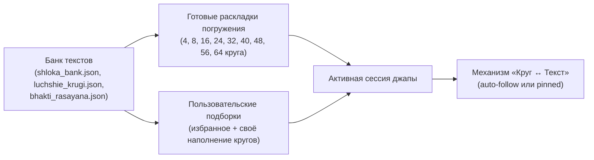
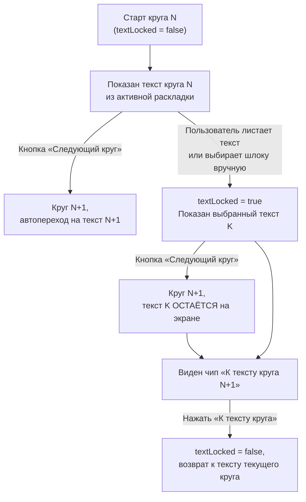
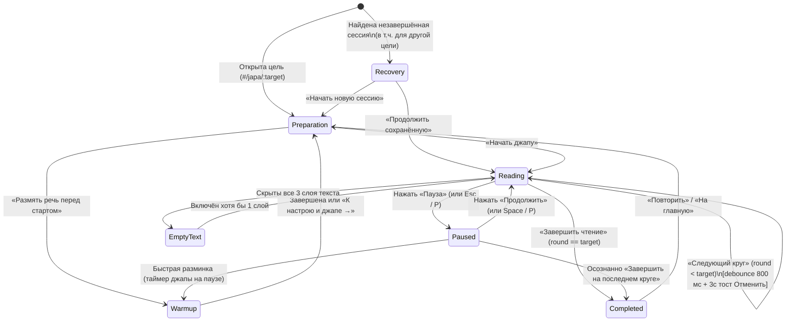
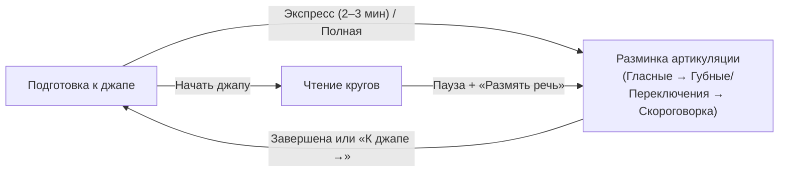

# Экран чтения джапы: детальный дизайн и архитектура UX

**Статус:** проработанная дизайн-спецификация для веб-приложения и будущих нативных клиентов. Нативные приложения, системные виджеты, Live Activity и облачная синхронизация между устройствами пока не реализованы.  
**Связанные документы:** [SPEC.md](SPEC.md), [ARCHITECTURE.md](ARCHITECTURE.md), [ROADMAP.md](ROADMAP.md).  
**Интерактивный прототип макетов:** [japa-reading-prototype.html](japa-reading-prototype.html) *(автономный HTML-стенд для проверки сценариев и компоновок в браузере)*.

---

## 1. О продукте и принципах экрана

«Помощник по джапе» помогает подготовить артикуляцию, настроиться и внимательно повторять мантру. Пользователь выбирает цель (`4, 8, 16, 24, 32, 40, 48, 56` или `64` круга), при необходимости проходит разминку и переходит к практике.

**Ключевые UX-принципы экрана чтения:**
1. **Спокойствие и фокус:** текст — главный визуальный центр; счётчик кругов и таймеры считываются мгновенно, но не суетятся (нет яркой анимации, мельканий и навязчивой графики).
2. **Независимость чтения от счёта:** перелистывание текстов не меняет номер круга; при этом поддерживается умное автоследование за кругом с возможностью зафиксировать любой текст.
3. **Готовность к длинным текстам:** тексты всегда помещаются по ширине без горизонтальной прокрутки, свободно скроллятся по вертикали и позволяют открыть полный источник без выхода из сессии.
4. **Безошибочность нажатий:** завершение круга защищено от случайных двойных нажатий и доступно под большой палец в горизонтальном и вертикальном режимах.

---

## 2. Модель данных, раскладки погружения и наполнение кругов

### 2.1. Единый принцип хранения (по аналогии с артикуляционной гимнастикой)

В модуле артикуляции уже используется разделение на **каталог единиц** ([catalog.ts](../web/src/catalog.ts)), **готовые программы по времени** ([programs.json](../web/data/programs.json)) и **пользовательские подборки по ID** ([collections.ts](../web/src/collections.ts)). Для чтения джапы применяется та же архитектура:



| Сущность | Роль | Ключевые поля |
|---|---|---|
| **Текстовая единица (`ShlokaRef`)** | Неделимый элемент настройки или стих из банка | `id`, `source`, `workId`, `workTitle`, `canonicalRef`, `verseNumber`, `totalVerses`, `theme`, `sanskrit`, `translation`, `instruction`, `fullContextLink` |
| **Раскладка цели (`JapaProgram`)** | Подготовленная последовательность текстов под конкретное число кругов, выстроенная по кривой погружения | `id`, `title`, `target` (`4..64`), `stages[]` (*Вхождение → Углубление → Кульминация → Благодарность*), `roundTextIds[]` |
| **Пользовательская коллекция (`JapaCollections`)** | Избранное и пользовательские раскладки (переопределение отдельных кругов или свой набор) | `favorites: string[]`, `layouts: { id, title, target, roundTextIds: string[] }[]` |

### 2.2. Готовые раскладки под все цели (`4..64`)

Чтобы погружение происходило естественно при любой цели (`4, 8, 16, 24, 32, 40, 48, 56, 64`), система предусматривает подготовку специальных раскладок:
- **Базовый канон (16 кругов):** настрои книги «16 кругов — Лучшие круги джапы».
- **Короткие цели (`4`, `8`):** сжатая кривая погружения (входной настрой → сердечная концентрация → молитвенное смирение → благодарность).
- **Расширенные цели (`24–64`):** комбинированные раскладки из «Лучших кругов» и шлок «Шри Бхакти-расаяны» (108+ шлок).
- **Запасной вариант (если раскладка для выбранной цели ещё не задана):** пользователь видит источник явно («Базовые 16 кругов (по кругу)» или «Бхакти-расаяна»), без тихого «застревания» на 16-м тексте.

### 2.3. Правило «Круг ↔ Текст» (автоследование с фиксацией)



- **При старте и в обычном ходе** экран автоматически открывает текст, назначенный текущему кругу.
- **Как только пользователь перелистал текст** (краем карточки, кнопкой или из выбора текстов), включается мягкая фиксация (`textLocked = true`): следующий круг **не сбивает** чтение.
- **Возврат в один тап:** рядом с индикатором текста появляется спокойный элемент **«К тексту круга N»**, снимающий фиксацию.
- **Полный текст без потери смысла:** если отображаемый фрагмент является частью произведения или сокращён, кнопка **«Полный текст»** открывает поверх экрана панель чтения (drawer/modal) со всем стихом/комментарием и переходом к соседним стихам произведения, **не прерывая сессию и таймер**.

---

## 3. Конечный автомат сессии, таймер и состояния

### 3.1. Диаграмма состояний



### 3.2. Поведение ключевых состояний

| Состояние | Что видит пользователь | Что происходит с таймером и данными |
|---|---|---|
| **Подготовка (`preparation`)** | Выбор цели (`4..64`), выбор/превью раскладки (готовая или своя подборка), блок **«Разминка речи перед джапой»** (экспресс / полная / пропустить), вводный настрой и настройки отображения. | Таймеры на нуле. Выбранные настройки отображения, темп артикуляции и раскладка сохраняются. |
| **Разминка (`warmup`)** | Сцена артикуляции в едином стиле: слоги или скороговорка, прогресс очереди упражнений и серий, режим «Диктор» (метроном + подсветка) или «Самостоятельно», кнопка **«Перейти к джапе →»**. | Если разминка открыта из активной сессии джапы, таймер круга автоматически стоит на **паузе**, чтобы время разминки не искажало статистику кругов. |
| **Чтение (`reading`)** | Номер круга (`Круг 4 из 16`), прогресс, **два таймера** (круг + всего), текст (санскрит, перевод, настройка), индекс текста, «Следующий круг». | Счёт идёт по разнице `Date.now() - roundStartedAt + elapsedRoundMs` (не зависит от частоты кадров). Сон/отключение экрана **не ставит** паузу автоматически. |
| **Пауза (`paused`)** | Иконка меняется на «Продолжить» (▶), на таймерах появляется текстово-иконочный бейдж **`⏸ Пауза`** (не только цвет!), панель управления мягко приглушается, текст остаётся доступным для спокойного чтения/листания. | Время круга и общее время фиксируются в `elapsedRoundMs` / `elapsedTotalMs`. |
| **Восстановление (`recovery`)** | Если в локальном хранилище найдена активная сессия (даже если пользователь открыл другой `#/japa/:target`), показывается явный баннер статуса: *«Найдена активная сессия: круг 6 из 16, на паузе / идёт (прошло 38 мин)»* + кнопки **«Продолжить»** и **«Начать заново»**. | Ничего не перезаписывается автоматически при открытии URL другой цели. |
| **Завершение (`completed`)** | Итоговая сводка: выполнено кругов, **общее время**, **среднее время круга**, развернутый список длительностей по кругам + **завершающие молитвы** (с учётом настроек санскрита/перевода/курсива). | Сессия помечается `completed: true` и сохраняется в историю. |
| **Отсутствие текста / все слои скрыты (`empty_text`)** | Если сняты все галочки (`Санскрит`, `Перевод`, `Настройка`) или выбранный текст пуст: спокойная заглушка *«Все части текста скрыты в настройках отображения»* + кнопка быстрого возврата **«Показать перевод и настройку»**. | Таймер и счётчик кругов продолжают работать без сбоев. |
| **Ошибка сохранения (`storage_error`)** | Неблокирующее предупреждение (`role="alert"`) под верхней строкой: *«Не удалось сохранить прогресс на устройстве. Сессия продолжается в памяти»* + кнопка «Повторить сохранение». | Работа экрана не блокируется; данные остаются в состоянии приложения до закрытия вкладки. |

### 3.3. Защита от случайных действий при переключении круга

1. **Защита от дребезга (`800 мс`):** кнопка «Следующий круг» игнорирует повторное нажатие в первые `800 мс`.
2. **Мягкий откат (`Undo` на 3 секунды):** после нажатия «Следующий круг» в нижней или боковой зоне на 3 секунды появляется ненавязчивый тост **`Круг 4 записан (06:42) · Отменить`**. Нажатие «Отменить» возвращает прошлый круг и восстанавливает его таймер с точностью до секунды (с учётом прошедших 3 секунд, если паузы не было).
3. **Последний круг (`round === target`):** кнопка меняет формулировку и визуальный акцент на **«Завершить чтение»** (в компактных интерфейсах — дополнительное подтверждение или короткое удержание, чтобы не закрыть практику случайно).

---

## 4. Компоновка по форм-факторам

### 4.1. Компьютер (Desktop / Tablet ≥ 900 px)

На широком экране сохраняется спокойная читательская колонка (`max-width: 740px`) с большим количеством свободного пространства по краям.

```text
┌─────────────────────────────────────────────────────────────────────────┐
│ [← Главная]     Круг 4 из 16  ·  [████░░░░░░░░░░░]        ⚙ Настройки   │
│                 Круг 06:42  ·  Всего 24:18  [⏸ Пауза]     ◷ История     │
├────┬───────────────────────────────────────────────────────────────┬────┤
│    │  Текст 4 из 16 · Лучшие круги · [Полный текст]  [↺ К кругу 4] │    │
│    │                                                               │    │
│ ‹  │                 Четвёртый круг · Слушание                     │  › │
│    │                                                               │    │
│    │    śrī-kṛṣṇa-nāma-karṇābhyāṁ śrutam antargataṁ hṛdi           │    │
│    │    (санскрит — выделяемый, переносится без обрыва слов)       │    │
│    │                                                               │    │
│    │    Литературный перевод стиха с комфортной длиной строки      │    │
│    │    (до 58–65 знаков) и спокойным межстрочным интервалом...    │    │
│    │                                                               │    │
│    │    Практическая настройка: «Слушайте звук своего голоса...»   │    │
│    │    [вертикальная прокрутка при длинном тексте]                │    │
├────┴───────────────────────────────────────────────────────────────┴────┤
│              [        Круг 4 завершён → Следующий (5)        ]          │
└─────────────────────────────────────────────────────────────────────────┘
```

**Детали Desktop-компоновки:**
- **Боковые зоны листания (`‹` / `›`):** вынесены в отдельные боковые поля (`48–56 px`) снаружи текстового контейнера или привязаны к фиксированной высоте карточки, чтобы **не перекрывать** выделение текста мышью и полосу прокрутки.
- **Панель настроек отображения:** компактный раскрывающийся блок (`Санскрит`, `Перевод`, `Настройка`, `Курсив` для каждого отдельно, размер шрифта текста, выбор раскладки/темы). Не смещает центр тяжести экрана.
- **История кругов:** открывается по запросу (в боковой/выдвижной панели или раскрывающемся блоке) — во время чтения не отвлекает.
- **Нижняя панель:** закреплена внизу (`sticky` внутри `100dvh`), не перекрывает последнюю строку текста (у области чтения есть нижний отступ `padding-bottom`).
- **Горячие клавиши:** `Space` / `Enter` — следующий круг (если фокус не на кнопке/поле), `ArrowLeft` / `ArrowRight` — предыдущий/следующий текст, `P` — пауза/продолжить, `R` — к тексту круга, `F` — полный текст, `Esc` — закрыть панель/пауза.

---

### 4.2. Телефон: горизонтальная ориентация (основной режим практики)

При горизонтальной ориентации высота экрана ограничена (~360–430 CSS px). Вертикальная стопка здесь не работает, поэтому применяется **двухколоночная split-компоновка** в границах `100dvh` и `env(safe-area-inset-*)`:

```text
┌─ safe-left ─────────────────────────────────────────────────────── safe-right ─┐
│ ┌───────────────────────────────────────────┐ ┌──────────────────────────────┐ │
│ │ Текст 4/16 · Источник     [Полный текст]  │ │ КРУГ 4 ИЗ 16   [████░░░░░░]  │ │
│ │ [‹ Пред.]    Слушание умом      [След. ›] │ │                              │ │
│ │ ───────────────────────────────────────── │ │ Круг   06:42   [ ⏸ ] [ ⚙ ]  │ │
│ │ śrī-kṛṣṇa-nāma...                         │ │ Всего  24:18   [ ◷ ]         │ │
│ │ Перевод стиха занимает всю доступную      │ │                              │ │
│ │ ширину левой колонки, без горизонтальной  │ │                              │ │
│ │ прокрутки. Если текст длинный — он        │ │ ┌──────────────────────────┐ │ │
│ │ плавно скроллится внутри этой области...  │ │ │                          │ │ │
│ │                                           │ │ │   СЛЕДУЮЩИЙ КРУГ (5)     │ │ │
│ │                                    [↓ ещё]│ │ │                          │ │ │
│ └───────────────────────────────────────────┘ └─┴──────────────────────────┴─┘ │
└────────────────────────────────────────────────────────────────────────────────┘
```

**Ключевые правила горизонтального режима:**
1. **Пропорции:** левая область чтения занимает ~`65–68%` ширины (`1fr`), правая панель управления — фиксированные `clamp(210px, 32vw, 270px)` (с опцией в настройках «Панель управления слева» для левшей).
2. **Ширина и скролл текста:** текст переносится строго в ширину читаемой колонки (`min-width: 0; overflow-wrap: anywhere`), не вылезая за экран. Если текст не помещается по высоте, скроллится **только текстовый контейнер** (`overflow-y: auto`), а правая панель с таймерами и кнопкой «Следующий круг» остаётся неподвижной. При переполнении снизу мягкий градиент/индикатор показывает, что есть продолжение.
3. **Два таймера в правой колонке:**
   - **Круг:** крупно (`06:42`, `tabular-nums`), чтобы считывалось боковым зрением.
   - **Всего:** спокойно под ним (`24:18`), показывая время всей джапы.
4. **Иконки-кнопки в правой колонке:** минимум `44×44 px` (с `aria-label` и понятным тултипом/подписью состояния):
   - **Пауза / Продолжить:** `⏸` / `▶` (при паузе рядом или поверх таймера виден явный статус `Пауза`).
   - **Настройки (`⚙`):** открывают настройки текста (показ слоёв, курсив, размер текста, режим «На подставке»).
   - **История (`◷`):** открывает список завершённых кругов в оверлее, не сбрасывая чтение.
5. **Крупная кнопка «Следующий круг»:** высота от `56 px` (до `72 px` при достаточной высоте), расположена в правом нижнем углу под большой палец.
6. **Навигация по текстам без краёв под вырезами:** перелистывание «Назад / Вперёд» размещено в верхней компактной строке текстовой карточки (или по краям **внутри** safe-area, не заходя под вырез камеры / жесты «Домой»).

---

### 4.3. Телефон: портретная ориентация (не блокируется)

Портретная ориентация остаётся полностью рабочей и адаптируется под `100dvh`:
- **Верх (фикс.):** компактная строка `←` · `Круг 4 / 16` · `Круг 06:42 · Всего 24:18` · `[⏸]` · `[⚙]`.
- **Центр (`flex: 1; min-height: 0; overflow-y: auto`):** карточка текста с кнопками перелистывания, индексом, источником и кнопкой «Полный текст».
- **Низ (фикс. + `safe-area-inset-bottom`):** кнопка **«Следующий круг»** во всю ширину (высота `56–60 px`).

---

### 4.4. Телефон на подставке во время зарядки (Dimmed Stand Mode)

Сценарий: телефон стоит на зарядке в горизонтальном (реже портретном) положении, пользователь сидит на расстоянии вытянутой руки или чуть дальше.
- **Переключение:** явный тумблер **«Режим на подставке»** в настройках экрана чтения (не зависит от системного автоповорота).
- **Внешний вид:**
  - Глубокий приглушённый тёмный фон (`#120e0b`), тёплый янтарно-кремовый текст пониженной яркости (`#d8cab8`), акцент приглушён (`#c96b3b`), убраны рамки карточек и второстепенные ссылки.
  - **Размер шрифта текста** автоматически увеличен на `+25–35%` (с сохранением пользовательской коррекции).
  - **Видимый минимум:** `4 / 16`, `06:42 · 24:18`, кнопка паузы (▶/⏸), текст настройки/шлоки и крупная кнопка «Следующий круг».
- **Платформенная оговорка:** удержание экрана (`Screen Wake Lock API` в вебе, `keepAwake` в нативных приложениях) и управление тепловыделением/яркостью при зарядке требуют отдельной реализации и проверки на реальных устройствах.

---

### 4.5. Часы (Watch — Apple Watch / Wear OS)

На маленьком экране часов пользователь выбирает **один главный режим**; остальные показатели не конкурируют за экран. Смена режима — в управлении/настройках приложения или горизонтальным пейджером/коронкой.

```text
  [1. Режим «Круг» (по умолчанию)]      [2. Режим «Таймер»]           [3. Режим «Текст»]
       ╭───────────────────╮               ╭───────────────────╮         ╭───────────────────╮
       │  06:42 · Всего24м │               │   Круг 4 из 16    │         │ Текст 4/16   [↻]  │
       │                   │               │                   │         │                   │
       │      4 / 16       │               │      06:42        │         │ śrī-kṛṣṇa-nāma... │
       │       круг        │               │   Всего 24:18     │         │ Повторяйте не как │
       │                   │               │                   │         │ судья, а как...   │
       │  ( Следующий ↻ )  │               │   (  ⏸ Пауза  )   │         │            [···]  │
       ╰───────────────────╯               ╰───────────────────╯         ╰───────────────────╯
```

**Детали по режимам часов:**
1. **«Круг» (рекомендуемый режим по умолчанию):**
   - В центре крупно `4 / 16` и подпись `круг`.
   - Сверху (мелко и спокойно): `06:42` или статус `⏸ Пауза`.
   - Снизу: крупная кнопка перехода к следующему кругу (на последнем — «Завершить»).
2. **«Таймер»:**
   - Крупное время текущего круга `06:42`, ниже компактно общее время `Всего 24:18`.
   - Явный не-цветовой статус (`⏸ Пауза` / `▶ Идёт`) и крупная кнопка Пауза / Продолжить.
3. **«Текст»:**
   - Один выбранный фрагмент крупным читаемым шрифтом, прокрутка цифровой коронкой / вертикальным свайпом.
   - Если фрагмент не умещается, обязательный маркер продолжения (`···` / `Читать далее`) и открытие полного текста на дочернем экране без обрыва смысла.
   - **Быстрая смена текста без ввода с клавиатуры:** короткий список по кнопке/иконке смены (`К тексту круга`, `Следующий/Предыдущий`, `Избранное`).
4. **Защита от ложных нажатий и геометрия экранов:**
   - Внутренние отступы от краёв (`safe inset`) для круглых циферблатов (не требовать нажатий в крайних `12–16%` углов).
   - Кнопка завершения круга отделена от перелистывания текста и защищена **удержанием (0.8 с с кольцевой шкалой)** либо **3-сек кнопкой «Отменить» + debounce `800 мс`** (выбор способа — в настройках часов).
5. **Программируемые аппаратные кнопки часов (нативная перспектива):**
   - Поддержка аппаратной кнопки (например, **Action Button** на Apple Watch Ultra или программируемой боковой кнопки на часах Wear OS) для действия **«Следующий круг»** (или «Пауза / Продолжить» по выбору пользователя) с тактильным откликом и защитой от случайного двойного нажатия. Это позволяет отмечать завершение круга вслепую, не глядя на циферблат.

---

### 4.6. Артикуляционная гимнастика (интеграция в единый дизайн-язык)

Артикуляционный тренажёр работает в тех же цветовых темах, типографике и адаптивных раскладках, что и экран чтения джапы, образуя единый поток **«Разминка → Настрой → Джапа»**.



**Единая механика и режимы тренажёра (на базе [machine.ts](../web/src/machine.ts)):**
- **Режим «Диктор» (по умолчанию):** обратный отсчёт (`1, 2`), метроном с раздельным темпом для слогов (`60 BPM` по умолчанию) и текстов-скороговорок (`120 BPM`), мягкая подсветка активного слога/слова (`.token.active`) и опциональный предпросмотр следующего слова во время паузы.
- **Режим «Самостоятельно»:** спокойное отображение слогов или скороговорки без таймера и автопереходов.
- **Прогресс без визуального шума:** три тонких линейки-пилюли (`.series`): *упражнение в программе → повтор (серия 1 из 3) → текущий слог/слово*.
- **Пауза с вуалью:** при нажатии на сцену или кнопку паузы показывается явный текстово-иконочный статус **`▶ Продолжить`**, а при переходе из активной джапы таймер круга джапы остаётся на паузе.

**Адаптация под форм-факторы:**

```text
  [Телефон · Горизонтально (Split 2/3 + 1/3)]              [Часы · Режим разминки]
  ┌──────────────────────────────┬───────────────────────┐    ╭─────────────────╮
  │ Упр. 2/5 · Губные П–Б–М   ★ │ Серия 1/3 · 60 BPM    │    │ Губные · 1/3    │
  │ ─── ─── [███] ─── ───        │ Осталось: 00:42       │    │                 │
  │                              │                       │    │      [ Б А ]    │
  │   ПА  [ БА ]  МА  ·  ПО      │ [ ▶/⏸ ]  [ ↺ ]  [ ⚙ ] │    │     ПА · МА     │
  │                              │                       │    │                 │
  │   (клик по сцене = пауза)    │ [ К джапе (16 кр.) → ]│    │  ( ⏸ / След. )  │
  └──────────────────────────────┴───────────────────────┘    ╰─────────────────╯
```

- **Компьютер:** широкая спокойная сцена по центру, боковые кнопки перехода между упражнениями (`‹` / `›`), компактный переключатель «Диктор / Самостоятельно», кнопка `★ В избранное` и заметный выход «К джапе →».
- **Телефон (горизонтальный split):** слева (2/3) — сцена со слогами или прокручиваемым текстом скороговорки; справа (1/3) — статус (`Серия N/M`, темп `BPM`, остаток времени), иконки управления (`▶/⏸`, `↺ Сброс`, `⚙ Темп/Порция`) и нижняя кнопка перехода к следующему упражнению или **«К джапе →»**.
- **Телефон (портрет и на подставке):** вертикальный стек `100dvh` с крупным активным слогом; в режиме `stand-dim` отключено яркое свечение токенов, используется тёплый акцент.
- **Часы:** на маленьком экране показывается **только активный слог/слово крупно** + соседние приглушённо, сверху `Серия 1/3` и темп, снизу одна кнопка `Старт / Пауза` (переход к следующему упражнению — отдельной командой без случайного сброса).

---

## 5. Системные поверхности (предварительные варианты)

Системные поверхности за пределами основного приложения зависят от ограничений ОС. **Ни один из нативных вариантов на текущем этапе не реализован и должен быть подтверждён прототипами.**

| Поверхность | Предлагаемый вид | Ограничение / что проверить |
|---|---|---|
| **iPhone StandBy при зарядке** | Системный виджет с кругом (`4 / 16`), таймером круга или коротким текстом; выбор содержимого в настройках виджета. | StandBy отображает только поддерживаемые системные виджеты, а не произвольный полноэкранный интерфейс. Проверить размеры, интерактивность (iOS AppIntent) и глубокую ссылку в активную сессию. |
| **iOS: домашний экран и экран блокировки** | Виджет прогресса кругов; для активной сессии — **Live Activity** + Dynamic Island (номер круга + live-таймер + кнопка паузы/круга). | Виджеты обновляются по бюджету системы; Live Activity имеет отдельный жизненный цикл (до 8–12 ч) и жёсткие лимиты на размер/обновления. |
| **Apple Watch** | Полноценное приложение watchOS (3 режима + поддержка Action Button); дополнительно complication / Smart Stack с одним показателем (`4 / 16`). | Жёсткие квоты на фоновое обновление complications. Не обещать собственный произвольный системный циферблат. |
| **Android** | Виджет прогресса или текста настройки с тапом в текущую сессию; постоянное уведомление активной сессии с таймером и действием «Следующий круг» / «Пауза». | Проверить политику фоновых служб и интерактивных RemoteViews на целевых версиях Android. |
| **Wear OS** | Приложение Wear OS (3 режима + аппаратная кнопка); дополнительно Tile или Complication. | Формат Watch Face Format (WFF) и тип complication ограничивают доступные элементы; проверить поддержку на круглых/квадратных экранах и публикацию в Google Play. |

**Официальные источники:**
- [Apple: Widgets and complications](https://developer.apple.com/documentation/widgetkit/widgets-and-complications-collection)
- [Apple: Keeping a widget up to date](https://developer.apple.com/documentation/widgetkit/keeping-a-widget-up-to-date)
- [Android: User interfaces on Wear OS](https://developer.android.com/training/wearables/user-interfaces)
- [Android: Watch Face Format — Complication](https://developer.android.com/reference/wear-os/wff/complication/complication)

---

## 6. Стиль, типографика и доступность

### 6.1. Цветовые темы и токены

Дизайн опирается на тёплую палитру [styles.css](../web/src/styles.css#L1-L29) и добавляет 3-ю тему — приглушённый режим для подставки:

| Токен | Светлая (`light`) | Тёмная (`dark`) | На подставке (`stand-dim`) | Назначение |
|---|---|---|---|---|
| `--paper` | `#f3eadc` | `#1b1612` | `#120e0b` | Основной фон страницы |
| `--card` | `#fffaf3` | `#28211b` | `#17120e` | Карточка чтения и панели |
| `--ink` | `#241910` | `#f6efe6` | `#d8cab8` | Основной текст (без ослепляющего белого в ночном режиме) |
| `--muted` | `#6d5848` | `#cbb8a6` | `#9f8d7c` | Вторичные подписи, источник, подсказки |
| `--line` | `#e2d3c0` | `#43362c` | `#2d231c` | Границы и разделители |
| `--accent` | `#b8431f` | `#e07a45` | `#c96b3b` | Главная кнопка «Следующий круг», активный индекс |
| `--accent-ink` | `#fff7f2` | `#1b120e` | `#140d09` | Текст на акцентной кнопке |

### 6.2. Типографика и диакритика (Google Noto Sans)

- **Основной шрифт:** **Google Noto Sans** (подключается явно веб-шрифтом с нужными подмножествами символов `cyrillic`, `latin`, `latin-ext`, а при наличии деванагари — `Noto Sans Devanagari`).
- **Проверка IAST-диакритики:** обязательная проверка рендеринга комбинируемых и составных знаков (`ā ī ū ṛ ṝ ḷ ṅ ñ ṭ ḍ ṇ ś ṣ ṁ ḥ` в обычном и *курсивном* начертаниях), чтобы диакритические точки и макроны не смещались вбок и не обрезались сверху/снизу (`line-height ≥ 1.65–1.8` для санскрита).
- **Таймеры и счётчики:** всегда `font-variant-numeric: tabular-nums`, чтобы цифры при тике секунд не «прыгали» по ширине.
- **Независимое масштабирование текста:** переменная `--reading-scale` изменяет размер санскрита, перевода и настройки отдельно от размеров кнопок управления и общей сетки.
- **Длина строки:** в широких окнах ширина текста ограничена `max-width: 60ch` (выравнивание для коротких стихов и длинной прозы — комфортное для чтения без разрыва слов, перенос `overflow-wrap: anywhere` как страховка для длинных санскритских сандхи).

### 6.3. Доступность (Accessibility)

- **Контраст:** не ниже `4.5:1` для основного текста и индикаторов во всех темах (включая `stand-dim`), не ниже `3:1` для крупных заголовков и иконок управления.
- **Не полагаться только на цвет:** пауза сопровождается иконкой `▶/⏸` и текстовым ярлыком «Пауза»; прогресс кругов дублируется текстом «Круг 4 из 16»; фиксация текста — подписью «К тексту круга N».
- **Зоны нажатия:** минимум `44×44 px` для иконок и вспомогательных кнопок, от `56 px` по высоте для «Следующий круг».
- **Фокус и клавиатура:** заметный `:focus-visible` (контур `3 px`), понятные `aria-label` на иконках паузы/истории/перелистывания, `aria-live="polite"` для объявления нового круга и паузы программами чтения экрана.
- **Системные настройки:** уважать `prefers-reduced-motion: reduce` (отключать сдвиги/анимации переходов), системный размер шрифта и `env(safe-area-inset-*)`.

---

## 7. Открытые решения и план проверки

### Что остаётся уточнить и подтвердить прототипами
1. **Синхронизация между устройствами:** определить модель хранения (сейчас используется только локальный `localStorage`), протокол разрешения конфликтов при одновременном продолжении сессии с телефона и часов, а также работу в офлайне (Service Worker / локальная БД).
2. **Контентные раскладки:** наполнить и вычитать специальные раскладки погружения для целей `4, 8, 24, 32, 40, 48, 56, 64` на основе «Лучших кругов», «Шри Бхакти-расаяны» и аштак, а также спроектировать UI редактора пользовательской раскладки кругов.
3. **Удержание экрана и заряд батареи:** проверить `Screen Wake Lock API` (веб) и нативные wake-lock/AOD режимы в сценарии телефона на подставке.

### Чек-лист проверки дизайна и макетов
- [ ] **Базовый поток:** старт сессии → чтение → «Следующий круг» → debounce 800 мс → Undo 3 сек → последний круг → «Завершить чтение» → экран сводки и молитв.
- [ ] **Развязка текста и круга:** автоследование → ручное перелистывание (фиксация) → смена круга с сохранением текста → «К тексту круга» → «Полный текст» без потери таймера.
- [ ] **Длинный текст:** длинная шлока/комментарий в горизонтальном телефоне (проверка ширины, вертикального скролла, доступности «Следующий круг»).
- [ ] **Особые состояния:** пауза (таймер не тикает, статус явный), восстановление после перезагрузки (в т.ч. для другой цели в URL), все части текста скрыты, ошибка записи в хранилище.
- [ ] **Поверхности и ввод:** портретный и горизонтальный телефон (вырезы/safe-area), узкий экран часов (круглый и прямоугольный, удержание/программируемая кнопка), навигация только с клавиатуры и проверка диктором экрана.
- [ ] **Артикуляционная связка:** старт разминки из подготовки и в перерыве джапы (таймер круга ставится на паузу), режимы «Диктор» и «Самостоятельно», подсветка слогов и длинных скороговорок в горизонтальном телефоне и на часах, плавный переход «К джапе →».
