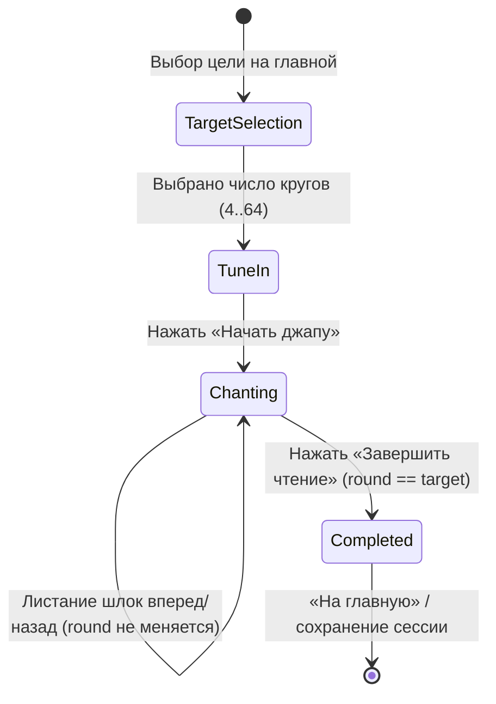

# SPEC — Функциональная спецификация

**Версия:** 2.0 · **Язык:** русский · **Статус:** рабочая спецификация.

Спецификация описывает функциональные требования к двум ключевым модулям приложения:
- **Раздел А:** Ассистент джапы (повторение мантры, покруговой настрой, счётчик, шлоки).
- **Раздел Б:** Артикуляционный тренажёр (разминка речевого аппарата перед джапой).
- **Раздел В:** Системные требования, хранение данных и критерии приёмки.

---

# Раздел А. Модуль ассистента джапы

## А.1. Пользовательские экраны и состояния



### 1. Экран выбора цели (Target Selection)
- **Расположение:** главная страница приложения и быстрый переход по прямой ссылке `#/japa/:target`.
- **Доступные цели (круги):** `[4, 8, 16, 24, 32, 40, 48, 56, 64]`.
- **UX элементов:** сетка чипов с крупными зонами нажатия (min 48×48 px). По умолчанию выделен канонический ориентир — **16 кругов**.
- **Быстрый старт:** кнопка «Настроиться и начать» сразу открывает выбранную цель.

---

### 2. Экран предварительной настройки (Tune-in Screen)
- **Цель:** собрать внимание, замедлить дыхание, переключить ум с бытовой суеты на духовную медитацию.
- **Содержание:**
  - Напоминание цели: «Цель: N кругов».
  - Базовое наставление из первой части книги «Лучшие круги»: 5 условий внимательного повторения (место, время, осанка, отказ от многословия, молитвенное смирение).
  - Наставление Шрилы Прабхупады: слышать каждое слово, не забегать вперед, не отставать.
- **Действие:** кнопка «Начать джапу» переводит сессию в активное состояние чтения первого круга.

---

### 3. Активный экран джапы (Active Chanting Screen)

Экран разделён на 4 функциональные зоны:

```
┌────────────────────────────────────────────────────────┐
│ [← Главная]          Сессия: 16 кругов         [⚙ Настройки] │
├────────────────────────────────────────────────────────┤
│                     КРУГ 3 ИЗ 16                       │
│ [████████████████░░░░░░░░░░░░░░░░░░░░░░░░░░░░░░░░░░░]  │
│ Время круга: 06:42           Общее время: 20:15        │
├────────────────────────────────────────────────────────┤
│                 КАРТОЧКА НАСТРОЙКИ                     │
│ Текст 3 из 16: Третий круг · Молитвенное смирение      │
│                                                        │
│ «Слушайте звук своего голоса. Повторяйте не как судья,  │
│ а как нищий, умоляющий о милости...»                   │
│                                                        │
│ трин̣а̄д апи сунӣчена тарор ива сахишн̣уна̄...            │
│ "Следует повторять святое имя в смиренном состоянии..." │
│                                                        │
│ [ ← Пред. текст ]     [ К тексту круга ]    [ След. текст → ] │
├────────────────────────────────────────────────────────┤
│                                                        │
│              [ СЛЕДУЮЩИЙ КРУГ ] (Крупная кнопка)       │
│                                                        │
└────────────────────────────────────────────────────────┘
```

#### Зона 1: Шапка и прогресс
- Текстовый индикатор: «Круг N из Target».
- Прогресс-бар (или круговой индикатор бусин чёток), наглядно отображающий долю выполненной практики.
- Таймер:
  - Время текущего круга (обнуляется при каждом нажатии «Следующий круг»).
  - Общее затраченное время сессии.
  - Среднее время круга (доступно по клику или в расширенном виде).

#### Зона 2: Карточка настройки и шлоки
- **Источники контента:**
  - Режим по умолчанию: «Лучшие круги» — 16 авторских медитаций, согласованных с номером круга.
  - Альтернативный режим: шлоки «Шри Бхакти-расаяны» (108+ шлок с санскритом и переводом).
- **Элементы карточки:**
  - Заголовок (номер и тема настройки).
  - Практический фокус для ума на данный круг.
  - Шлока на санскрите (транслитерация/деванагари при наличии).
  - Пословный или литературный перевод.
  - Источник (Падма Пурана, Чайтанья-чаритамрита, Бхагавад-гита и др.).

#### Зона 3: Независимая навигация по текстам (Развязка со счётчиком)
- **Принцип работы:** пользователь может листать тексты и шлоки в своём ритме, изучая комментарии или повторяя предыдущие стихи.
- **Элементы управления:**
  - Кнопка «← Предыдущий текст» (уменьшает `textIndex` на 1, min 1).
  - Кнопка «Следующий текст →» (увеличивает `textIndex` на 1, max Total).
  - Индикатор позиции: «Текст K из M».
  - Кнопка возврата: «К тексту круга» — возвращает отображение к тексту, номер которого совпадает с текущим кругом.
- **Поведение при смене круга:**
  - Если пользователь не листал тексты вручную (`textIndex === round`), нажатие кнопки «Следующий круг» автоматически открывает настройку для следующего круга.
  - Если пользователь зафиксировал конкретную шлоку вручную, приложение сохраняет его выбор или мягко уведомляет о готовности новой настройки.

#### Зона 4: Главная кнопка действия (Primary Action Button)
- **Текст:** «Следующий круг» (при `round < target`); «Завершить чтение» (при `round === target`).
- **Визуальные параметры:**
  - Самая крупная и контрастная кнопка на экране (высота не менее 56 px).
  - Зафиксирована в нижней части экрана или хорошо доступна для нажатия большим пальцем.
- **Защита от случайного нажатия (Debounce):**
  - Блокировка повторного клика на 800 мс во избежание случайного переключения двух кругов подряд.
- **Обратная связь при нажатии:**
  - Тактильный отклик (Web Vibration API, 50 мс на мобильных устройствах).
  - Опциональный тихий звуковой сигнал (мягкий щелчок бусины или звук каратал).

---

### 4. Экран завершения (Completion Screen)
- **Итоговая статистика:**
  - Выполнено: N кругов.
  - Общее время сессии: часы и минуты.
  - Среднее время круга (например, 7 мин. 15 сек.).
- **Молитва об устранении оскорблений:**
  - Текст из главы 99 книги «Лучшие круги» (*на̄ма̄пара̄дха-йукта̄на̄м̇...*).
  - Благодарность и завершающая медитация.
- **Действия:**
  - «Сохранить в историю».
  - «Вернуться на главную».

---

## А.2. Системные функции джапа-ассистента
1. **Screen Wake Lock API:** во время активного экрана джапы браузер запрашивает удержание экрана (`navigator.wakeLock.request('screen')`), чтобы дисплей не гас во время чтения круга. При уходе со страницы или завершении сессии блокировка освобождается.
2. **Горячие клавиши:**
   - `Space` или `Enter` — следующий круг.
   - `ArrowLeft` / `ArrowRight` — предыдущий/следующий текст настройки.
   - `Esc` — пауза или подтверждение выхода.
3. **Сохранение состояния (Session Recovery):** при случайной перезагрузке страницы или сворачивании браузера текущий круг, цель и время сессии восстанавливаются из `localStorage`.

---

# Раздел Б. Модуль подготовки артикуляции

## Б.1. Каталог и упражнения
- **Гласные (5 категорий):**
  1. Гласная лестница (прямая и обратная).
  2. Маятники (А–И, И–У, И–Ы, А–О, Э–У).
  3. Перестановки троек (А–О–У, И–Э–Ы).
  4. Йотированные сочетания (Я–А, Ё–О, Ю–У, Е–Э).
  5. Сверхцепочки и смешанные матрицы.
- **Согласные (10 групп × 3 ступени):**
  - Губные (П–Б–М), губно-зубные (Ф–В), переднеязычные (Т–Д–Н), свистящие (С–З–Ц), шипящие (Ш–Ж–Ч–Щ), заднеязычные (К–Г–Х), сонорные (Р–Л, Й).
  - Каждая группа включает: слоги, переходы и закрепляющую фразу.
- **Скороговорки (11 тематических текстов):**
  - Авторские тексты на вайшнавские сюжеты (Путана, Шакатасура, Тринаварта, Калия, Говардхан, Раса-лила и финальная супер-скороговорка).
  - Разметка по фразам и сегментам.

## Б.2. Проигрыватель и метроном
- Машина состояний: `idle → countdown → running → resting → completed` (с поддержкой `paused`, `cancelled`).
- Метроном: Web Audio API с lookahead-планированием звуков. Диапазон 30–240 BPM.
- Режимы отображения: статический текст, подсветка активного слога, последовательная подача.

---

# Раздел В. Модели данных (TypeScript Contracts)

```ts
// Цели джапы
export type JapaTarget = 4 | 8 | 16 | 24 | 32 | 40 | 48 | 56 | 64;

// Текст настройки на круг
export interface TuneInText {
  id: string;
  bookSource: 'luchshie-krugi' | 'bhakti-rasayana';
  roundNumber?: number; // 1..16 для «Лучших кругов»
  title: string;
  focusMessage: string; // Практическое наставление для ума
  shlokaSanskrit?: string;
  shlokaTranslit?: string;
  translationRu: string;
  sourceReference: string; // Например, «Падма Пурана, ЧЧ Мадхья 17.133»
}

// Активная сессия джапы
export interface JapaSession {
  id: string;
  targetRounds: JapaTarget;
  currentRound: number; // 1..targetRounds
  currentTextIndex: number; // Индекс отображаемого текста (развязан со счётом)
  startedAt: number; // timestamp
  roundStartedAt: number; // timestamp
  roundDurationsSeconds: number[]; // Длительность каждого завершённого круга
  isCompleted: boolean;
  notes?: string;
}

// Запись в истории
export interface JapaHistoryRecord {
  id: string;
  date: string; // ISO string
  targetRounds: number;
  completedRounds: number;
  totalDurationSeconds: number;
  averageRoundSeconds: number;
}
```

---

# Раздел Г. Критерии приёмки

1. **Джапа — выбор цели:** пользователь может в 1 клик выбрать цель из ряда 4, 8, 16, 24, 32, 40, 48, 56, 64 круга.
2. **Джапа — преднастройка:** перед началом выводится духовный настрой и наставление о внимании.
3. **Джапа — счётчик кругов:** кнопка «Следующий круг» корректно инкрементирует круг, обновляет прогресс-бар и защищена от случайных дабл-тапов (debounce 800 мс).
4. **Джапа — развязка текстов:** перелистывание шлок стрелками изменяет отображаемый текст, но ни при каких обстоятельствах не изменяет номер текущего круга.
5. **Джапа — завершение:** по достижении целевого круга предлагается молитва об устранении оскорблений и сводка времени.
6. **Артикуляция:** все упражнения для гласных, 10 групп согласных и 11 скороговорок доступны и воспроизводятся с метрономом.
7. **Адаптивность:** интерфейс комфортен для использования со смартфона, удерживаемого в одной руке во время чтения на чётках.
8. **Автономность:** приложение работает без интернет-соединения после первой загрузки (offline-first).
